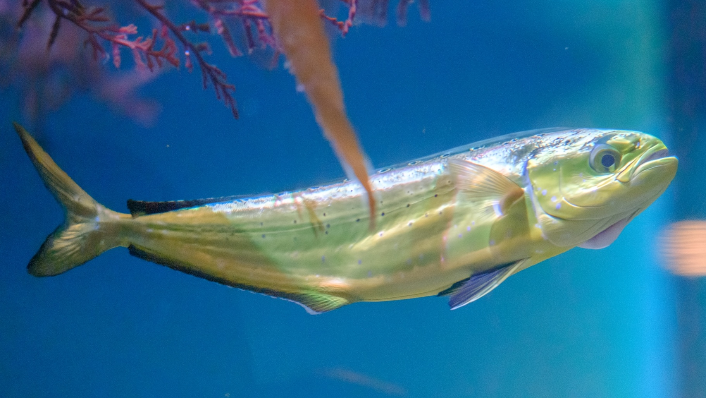

# mahimahi


photo credit: Juvenile Mahimahi at the Monterey Bay Aquarium, [https://www.inaturalist.org/photos/254881543].

[](https://github.com/QVEU/mahimahi/actions/workflows/tests.yml)

Strand-specific read counting for **S**ingle **C**ell **I**solated **S**trand
**S**pecific **O**bservation of **R**eplication **S**tate (SCISSORS)
experiments, from the Quantitative Virology and Evolution Unit (QVEU) at NIAID.

mahimahi takes 10x single-cell FASTQs and produces one table: for every cell
and every template in your reference, how many distinct positive-strand and
negative-strand UMIs it saw. For a (+)-strand RNA virus the negative strand is
the replication intermediate, so (−)/(+) measures replication rather than
viral load.

```
FASTQ  ──align (minimap2)──►  BAM  ──count UMIs per cell × template × strand──►  counts TSV
```

What you do with the table afterwards (QC, clustering, joining to a Seurat or
scanpy object, figures) is up to you; none of that lives here.

## 1. Install

You need `git` and conda. If you don't have conda, install
[Miniforge](https://github.com/conda-forge/miniforge#install), which comes
set up for conda-forge.

Get the code from GitHub:

```bash
git clone https://github.com/QVEU/mahimahi.git
cd mahimahi
```

(Or `git clone git@github.com:QVEU/mahimahi.git` if you use SSH keys with
GitHub. The repository is public, so no login is needed to clone it.)

Then create the environment and check it works:

```bash
conda env create -f workflow/envs/mahimahi.yaml
conda activate mahimahi
bash tests/workflow/run_workflow_tests.sh     # checks the install on built-in example data
```

The last line should end with `# Workflow tests: all passed.` The environment
is small (Python, Snakemake, pysam, pandas, minimap2, samtools) and solves on
Linux, Intel Macs and Apple Silicon.

To update later, pull the latest code and refresh the environment:

```bash
cd mahimahi
git pull
conda env update -f workflow/envs/mahimahi.yaml --prune
```

Run all the commands below from inside the `mahimahi` folder.

## 2. Go from FASTQs to a counts TSV

**a. A reference FASTA.** One entry per thing you want counted separately:
the viral genome, plus any reporters (`eGFP`, `mRuby3`, ...) that tell
co-infecting templates apart. Entry names become the
`ref_name` column, so name them as you want them in figures. Optionally, add
a stretch of a host mRNA (e.g. *GAPDH*) as a strandedness check: it is counted
like any other entry and should come out almost entirely `Pos` (step e).

**b. A sample sheet**, `config/samples.tsv`, one row per sample. For a
standard 10x run you give the R2 (cDNA) FASTQ as `input` and the R1
(barcode + UMI) FASTQ as `r1_fastq`:

```
sample    input                              r1_fastq                           barcode_source
WT_rep1   /data/run1/WT_S1_R2_001.fastq.gz   /data/run1/WT_S1_R1_001.fastq.gz   paired_fastq
```

Columns are tab-separated. Delete the shipped `EXAMPLE_` rows; the workflow
refuses to run while they are there.

**c. The config**, `config/config.yaml`. The settings that matter:

| setting | set it to |
| --- | --- |
| `template` | path to the FASTA from step a |
| `barcode.barcode_length`, `barcode.umi_length` | your 10x kit: 16 + 12 for 3' v3/v3.1 and 5' v3; 16 + 10 for 3' v2 and 5' v1/v2 |
| `strand.convention` | `reverse_is_positive` (default) |
| `outputs.keep_bam` | `true` to keep the aligned BAM (with index) |

Every sample-specific value lives in these two files. For several experiments
with different references, make one config per experiment and pass it with
`--configfile config/<experiment>.yaml`.

`config/config.yaml` explains every setting in comments.
`config/config.simple.yaml` has the same settings and defaults with no
comments, if you'd rather start from a short file. To use it, edit it and run
with `--configfile config/config.simple.yaml`, or copy it as the starting
point for your own per-experiment configs.

**d. Run it.**

```bash
snakemake --cores 8 -n      # dry run: shows what will happen
snakemake --cores 8         # writes results/mahimahi_counts.tsv.gz
```

On a cluster, the same command runs inside a single job (for example
`sbatch --cpus-per-task=8 --wrap "snakemake --cores 8"`).

**e. Check the strand call, then use the table.** Open
`results/strand_qc_summary.tsv`: viral templates should be mostly
positive-sense, typically with `neg_over_pos` around 0.005–0.05, and a host
mRNA entry, if you added one, nearly 100% positive-sense. Mostly
negative-sense across the board means `strand.convention` is set the wrong
way round.

## 3. The output

`results/mahimahi_counts.tsv.gz` has one row per (cell, template), across all
samples:

| column | meaning |
| --- | --- |
| `CBC` | cell barcode |
| `ref_name` | template (a FASTA entry) |
| `sample` | sample name from `config/samples.tsv` |
| `datalabel` | sample name without a trailing `_S<n>`, so runs of one sample group together (override with a `datalabel` column) |
| `CBC_readcount` | reads for this cell, before UMI collapsing |
| `UMI_count` | distinct UMIs for this cell, across all templates and strands |
| `Pos`, `Neg` | distinct positive- and negative-strand UMIs for this cell and template |
| `Neg_PosRatio` | `Neg / (Pos + 1)` |
| `Rep_Index` | `Neg / (Pos + Neg)` |

Per sample, `results/<sample>/` also holds `counts_long.tsv.gz` (one row per
cell × template × strand), `strand_qc.tsv`, `extract_stats.json` (how many
reads were kept and why the rest were dropped) and logs for every step.

## Other kinds of input

The `input` column also accepts files that already carry the barcode. Set
`barcode_source` per row, or once in `config/config.yaml`:

| You have | `input` | `barcode_source` |
| --- | --- | --- |
| Raw 10x R1 + R2 FASTQs | R2 FASTQ, with R1 in `r1_fastq` | `paired_fastq` |
| DRAGEN scRNA FASTQ (barcode+UMI in the read name) | the FASTQ | `read_name` |
| Cell Ranger `possorted_genome_bam.bam` | the BAM | `tags` |

BAM inputs are counted as they are aligned (the FASTA is not used, and
`ref_name` comes from the BAM header). An optional `whitelist` column takes a
called-cell list (`barcodes.tsv.gz`, or a DRAGEN `*.scRNA.barcodeSummary.tsv`)
to restrict counting to real cells.

## Tests

```bash
bash tests/workflow/run_workflow_tests.sh
```

Builds nothing and needs no data: the committed fixtures in
`tests/workflow/fixtures/` are synthetic reads with known per-cell,
per-template, per-strand UMI counts. UMI sequences are reused across cells,
templates and strands, and decoy reads (unmapped, multimapping, secondary,
supplementary, low MAPQ, missing barcode) are mixed in. The suite runs all
three input types, checks every count and every filtered read against that
truth, and checks that a second run does nothing. CI runs it
on Linux and macOS for every push.

[docs/REAL_DATA.md](docs/REAL_DATA.md) is the checklist for running on the
lab's own samples. [NEWS.md](NEWS.md) records what changed from the original
scripts.

## License and citation

Public domain (CC0; US Government work, 17 USC 105). See
[CITATION.cff](CITATION.cff).
